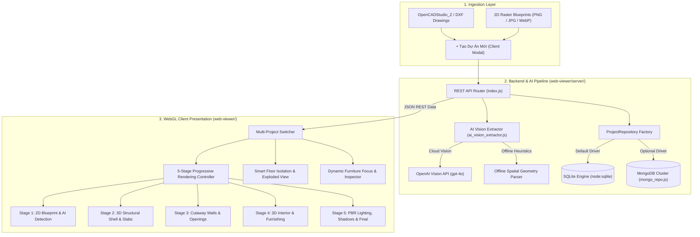

# AI 2D-to-3D Architectural Web Platform & CAD/BIM Dollhouse Viewer
## Nếp Nhà | Hồ Sơ Kiến Trúc & Trình Diễn Mô Hình 3D Đa Dự Án

---

## 1. Executive Summary & Architecture Overview

The **AI 2D-to-3D Architectural Web Platform** (`web-viewer/`) is an enterprise-grade, full-stack platform designed to transform 2D architectural drawings, CAD files (`.dxf`), and raster floorplan images into photorealistic, interactive 3D BIM dollhouse models rendered directly in modern web browsers via WebGL and Three.js.

The platform unifies:
1. **Desktop CAD Authoring (OpenCADStudio_Z):** Rust native CAD engine outputting standard DXF/DWG vector geometry.
2. **AI Vision Extraction Pipeline:** Dual-mode pipeline featuring OpenAI Vision (`gpt-4o`) for cloud-based spatial blueprint analysis and an intelligent offline spatial geometry parser for local zero-latency CAD processing, Vietnamese Feng Shui calculations, and parametric cost estimations.
3. **Multi-Project REST API & Storage Layer:** Pluggable storage architecture featuring Node.js 24's zero-dependency built-in `node:sqlite` (`DatabaseSync`) by default and a scalable `MongoDB` adapter.
4. **5-Stage Progressive Rendering Client:** Interactive Three.js WebGL viewport allowing clients and architects to inspect drawings progressively from 2D AI detection overlays through structural shells, cutaway walls, interior furnishing, up to full PBR lighting and shadows.



---

## 2. Multi-Project Domain Models & Schema Specification

The multi-project domain models are defined in `web-viewer/server/models.js` and shared conceptually with the client pipeline in `web-viewer/js/cad_bim_pipeline.js`.

### 2.1 Schema Definition: `ProjectDocument` & `FloorDocument`

```javascript
ProjectDocument {
  id: string,               // Unique slug (e.g. 'nha-pho-4-tang-5x8')
  title: string,            // Display title (e.g. 'Nhà phố 4 Tầng Hiện Đại (5 × 8 m)')
  code: string,             // Project code (e.g. 'NN-2026-NP04')
  subtitle: string,         // Technical dossier subtitle
  scale: string,            // Drawing scale (e.g. '1:100')
  unit: string,             // Dimension unit ('mm' | 'm')
  lot_width: number,        // Lot width in meters
  lot_length: number,       // Lot length in meters
  lot_area: number,         // Site area in m²
  total_floor_area: number, // Computed sum of floor areas in m²
  metadata: {
    author: string,         // Architect name
    style: string,          // Architectural style
    orientation: string,    // Building orientation (e.g. 'Nam (South)')
    estimatedCostVND: number,
    tags: string[],
    createdAt: string,
    updatedAt: string
  },
  floors: FloorDocument[]
}

FloorDocument {
  id: string,               // Floor identifier (e.g. 'floor_1')
  name: string,             // Floor name (e.g. 'Tầng 1')
  desc: string,             // Functional description
  elevation: number,        // Relative vertical elevation Y in meters (e.g. 0.0, 3.8, 7.2)
  height: number,           // Story clear height in meters (e.g. 3.8, 3.4)
  boundary: number[][],     // Polygon vertices [[x1, y1], [x2, y2], ...]
  rooms: [
    {
      name: string,         // Room name ('Phòng khách', 'Bếp & Ăn', 'Phòng thờ')
      area: number,         // Room area in m²
      function: string,     // Functional zone code ('living', 'kitchen', 'bedroom', 'altar')
      bounds: [x1, y1, x2, y2]
    }
  ],
  entities: CADEntity[],    // Vector entities (LINE, LWPOLYLINE, INSERT, TEXT, CIRCLE)
  aiAnalysis: Object        // AI extraction result (rooms, furniture, feng shui, costs)
}
```

### 2.2 Built-in Seed Architectural Projects

The repository includes two fully realized architectural projects seeded automatically upon initial startup:

1. **Nhà phố 4 Tầng Hiện Đại (5 × 8 m) (`nha-pho-4-tang-5x8`):**
   - 4 full stories (Tầng 1: Living/Kitchen/WC; Tầng 2: Master Bed/Dressing/WC; Tầng 3: 2 Bedrooms/WC; Tầng 4: Altar/Gym/Laundry/Terrace).
   - 24 detailed CAD furniture items (Italian leather sofa, teak dining table, ancestral altar, treadmill, glass shower).
   - Total floor area: 160.0 $m^2$.

2. **Biệt thự Sân vườn 3 Tầng (12 × 16 m) (`biet-thu-san-vuon-3-tang-12x16`):**
   - 3 full stories with surrounding landscaped lot (18 × 24 m).
   - Features: Outdoor swimming pool, poolside loungers, sauna room, home gym, rooftop garden, ancestral shrine.
   - 37 detailed CAD furniture items.
   - Total floor area: 520.0 $m^2$.

---

## 3. Storage Layer & MongoDB Migration Instructions

The platform provides a dual-storage abstraction managed through the `ProjectRepository` interface (`web-viewer/server/repository.js`).

### 3.1 Default SQLite Storage (`SqliteProjectRepository`)

- **Engine:** Built-in Node.js 24 `node:sqlite` (`DatabaseSync`).
- **Zero Third-Party Dependency:** Requires no native compilation (`node-gyp`), external binaries, or system libraries.
- **Persistence Location:** `web-viewer/data/nepnha_projects.sqlite`.
- **Schema:**
  ```sql
  CREATE TABLE IF NOT EXISTS projects (
    id TEXT PRIMARY KEY,
    title TEXT NOT NULL,
    code TEXT,
    subtitle TEXT,
    lot_width REAL DEFAULT 0.0,
    lot_length REAL DEFAULT 0.0,
    lot_area REAL DEFAULT 0.0,
    total_floor_area REAL DEFAULT 0.0,
    floors_count INTEGER DEFAULT 0,
    data TEXT NOT NULL,
    created_at TEXT,
    updated_at TEXT
  );
  CREATE INDEX IF NOT EXISTS idx_projects_code ON projects(code);
  CREATE INDEX IF NOT EXISTS idx_projects_title ON projects(title);
  ```

### 3.2 MongoDB Adapter (`MongoProjectRepository`)

The MongoDB repository (`web-viewer/server/mongo_repo.js`) allows enterprise deployment to MongoDB Atlas or local MongoDB clusters. It supports native JSON document indexing, high-concurrency read/write operations, and dynamic driver loading.

### 3.3 Step-by-Step MongoDB Migration Guide

To migrate from SQLite to MongoDB in production:

#### Step 1: Install the official MongoDB Node.js driver
```bash
cd web-viewer
pnpm add mongodb
```

#### Step 2: Configure Environment Variables
Set the database driver and connection URI in your environment or `.env` file:
```bash
# Enable MongoDB Driver
DATABASE_DRIVER=mongodb

# Connection URI (Local or MongoDB Atlas)
MONGODB_URI=mongodb://localhost:27017/nepnha
# For MongoDB Atlas:
# MONGODB_URI=mongodb+srv://<username>:<password>@cluster0.abcde.mongodb.net/nepnha?retryWrites=true&w=majority

# Target Database Name
MONGODB_DB_NAME=nepnha
```

#### Step 3: Run the Automated SQLite-to-MongoDB Data Migration Script
Create and execute the migration script below to copy all existing projects from SQLite into MongoDB:

```javascript
// web-viewer/server/migrate_sqlite_to_mongo.js
import { SqliteProjectRepository } from './sqlite_repo.js';
import { MongoProjectRepository } from './mongo_repo.js';

async function migrate() {
  console.log('--- Starting Data Migration: SQLite -> MongoDB ---');
  const sqliteRepo = new SqliteProjectRepository();
  const mongoRepo = new MongoProjectRepository();

  await sqliteRepo.init();
  await mongoRepo.init();

  const projects = await sqliteRepo.findAll({ summaryOnly: false });
  console.log(`Found ${projects.length} projects in SQLite database.`);

  let migratedCount = 0;
  for (const project of projects) {
    console.log(`Migrating: [${project.id}] "${project.title}"...`);
    await mongoRepo.save(project);
    migratedCount++;
  }

  console.log(`✓ Migration complete! Successfully transferred ${migratedCount} projects.`);
  await sqliteRepo.close();
  await mongoRepo.close();
}

migrate().catch(console.error);
```

Execute migration:
```bash
node server/migrate_sqlite_to_mongo.js
```

#### Step 4: Verify MongoDB Persistence
Start the server with `DATABASE_DRIVER=mongodb`:
```bash
DATABASE_DRIVER=mongodb pnpm server
```
Query `/api/health` to confirm the active driver:
```bash
curl http://localhost:3000/api/health
# Response: {"status":"ok","driver":"MongoProjectRepository", ...}
```

---

## 4. AI Vision Extraction Pipeline

The extraction pipeline (`web-viewer/server/ai_vision_extractor.js`) bridges raster floorplans and CAD geometry into structured architectural models.

### 4.1 Cloud-Based OpenAI Vision Integration (`gpt-4o`)

When an `OPENAI_API_KEY` is provided, the platform dispatches high-resolution base64 floorplan images directly to the OpenAI Vision API (`https://api.openai.com/v1/chat/completions`) using model `gpt-4o`.

#### System Prompt & Structured Output Contract
```json
{
  "source": "openai_vision",
  "model": "gpt-4o",
  "timestamp": "2026-11-12T10:00:00.000Z",
  "confidence": 0.94,
  "summary": "Mặt bằng Tầng 1 bố trí không gian mở hiện đại với phòng khách, bếp và sân sau.",
  "rooms": [
    { "name": "Phòng khách", "areaM2": 24.5, "zone": "living", "notes": "Liền kề sảnh chính" },
    { "name": "Bếp ăn", "areaM2": 18.0, "zone": "kitchen", "notes": "Bếp chữ L kết hợp bàn đảo" }
  ],
  "furniture": [
    { "type": "sofa", "name": "Sofa chữ L da cao cấp", "location": "Góc phòng khách" },
    { "type": "dining_table", "name": "Bàn ăn 6 ghế", "location": "Giữa phòng ăn" }
  ],
  "metrics": {
    "grossAreaM2": 65.0,
    "usableAreaM2": 58.2,
    "circulationRatioPct": 10.5,
    "daylightExposurePct": 88.0
  },
  "fengShui": {
    "doorOrientation": "Hướng Đông Nam (Sinh Khí)",
    "ventilationAssessment": "Thông gió xuyên phòng tốt giữa mặt trước và sân sau",
    "recommendations": [
      "Bố trí bếp tọa hung hướng cát, tránh nhìn thẳng ra cửa chính",
      "Ban thờ đặt tại vị trí trang trọng tầng cao nhất"
    ]
  },
  "costEstimationVND": {
    "roughConstruction": 360000000,
    "interiorFitOut": 220000000,
    "total": 580000000
  }
}
```

### 4.2 Offline Spatial Geometry Parser (Zero-Cloud Mode)

When running offline or without an OpenAI API key, the engine automatically falls back to the deterministic spatial parser:
- **Wall & Column Clustering:** Clusters `A-WALL`, `A-WALL-EXTR`, `A-WALL-INTR`, and `A-COLS` entities to delineate interior and exterior boundaries.
- **Bounding Box Object Recognition:** Analyzes `INSERT` blocks and geometric clusters to identify furniture types (`sofa`, `bed`, `dining_table`, `toilet`, `altar`, `gym`, `pool`).
- **Vietnamese Architectural Feng Shui (Bát Trạch):** Calculates building orientation vectors and assesses door/stair alignment with traditional residential principles.
- **Parametric Cost Heuristics:** Computes standard Vietnamese construction costs based on total floor area:
  - Phần thô & nhân công hoàn thiện: 3,800,000 – 4,500,000 VND / $m^2$.
  - Hoàn thiện nội thất tiêu chuẩn khá: 2,500,000 – 3,500,000 VND / $m^2$.

---

## 5. 5-Stage Progressive Rendering Pipeline

The client viewport incorporates a 5-stage progressive rendering toolbar, allowing users to inspect each layer of construction:

| Stage | Name | Visual Components Visible | Hidden Elements | Architectural Purpose |
|---|---|---|---|---|
| **Stage 1** | **2D Blueprint & AI Detection** | 2D Blueprint SVG overlay, AI detected room zones, bounding boxes, confidence tags | All 3D walls, furniture, lighting | Verifies AI detection accuracy against raw 2D input. |
| **Stage 2** | **3D Structural Shell & Slabs** | Reinforced concrete slabs (`A-3D-SLAB`), structural columns (`A-COLS`), stair void | Walls, doors, windows, furniture | Structural engineering audit; inspects column grid and floor thickness. |
| **Stage 3** | **Architectural Cutaway Walls** | Structural slabs, exterior cutaway walls (1.2m cut plane), interior partition walls, doors (`A-DOOR`), windows (`A-GLAZ`) | Furniture, lighting | Architectural space planning; reviews room flow and door swings. |
| **Stage 4** | **3D Interior & Furnishing** | All Stage 3 elements + parametric 3D furniture placed at AI coordinates (`A-FURN`, `A-SANR`) | Interior ceiling lighting | Interior layout review; ergonomically checks furniture clearance. |
| **Stage 5** | **PBR Lighting, Shadows & Final** | Complete building, PBR materials, warm 3000K interior spotlights, dynamic shadows, site landscape, 3D room markers | None (Full presentation) | Client presentation; realistic architectural visualization. |

---

## 6. Smart Floor Control & Interactive Client Features

### 6.1 Smart Floor Isolation
- Selecting any floor card (e.g. `Tầng 2`) in a multi-story building immediately:
  1. Hides all floors above it (`Tầng 3`, `Tầng 4`), providing an unobstructed top-down view of the active story.
  2. Keeps the active floor and all supporting floors below visible to maintain structural context.
  3. Updates the bottom-left 2D SVG floorplan thumbnail to the selected floor.
  4. Animates the Three.js camera position and OrbitControls target smoothly to the floor's centroid.

### 6.2 "Tách Tầng" (Exploded Floor View)
- Activating "Tách tầng" deploys an interactive vertical separation slider ($0\text{ m} \to 10\text{ m}$).
- Dynamically offsets each story's vertical group along the Y-axis:
  $$\Delta Y_i = \text{elevation}_i + (i \times \text{separationDistance})$$
- Allows full 360° inspection between floor sandwiches without hiding any structure.

### 6.3 Dynamic Furniture Focus & Inspector
- The "CHI TIẾT NỘI THẤT" dropdown is dynamically populated from the active project's CAD entities and AI detection catalog.
- Selecting any item:
  - Teleports and orbits the 3D camera directly toward the furniture piece.
  - Wraps the 3D object in an animated bounding-box wireframe helper.
  - Displays the Object Inspector card with CAD layer name, exact dimensions ($L \times W \times H$), specified material (e.g., *Gỗ gõ đỏ Nam Phi, Da bò Ý*), and host floor.

---

## 7. REST API Reference

The backend server listens on `http://localhost:3000` by default.

### `GET /api/health`
Returns server status, uptime, and the active database driver.
- **Response:** `200 OK`
```json
{
  "status": "ok",
  "uptime": 142.5,
  "driver": "SqliteProjectRepository",
  "timestamp": "2026-11-12T10:45:00.000Z"
}
```

### `GET /api/projects`
Retrieves all projects. Accepts optional `?summary=true|false` (default: `true`).
- **Response:** `200 OK`
```json
{
  "success": true,
  "count": 2,
  "data": [
    {
      "id": "nha-pho-4-tang-5x8",
      "title": "Nhà phố 4 Tầng Hiện Đại (5 × 8 m)",
      "code": "NN-2026-NP04",
      "lot_width": 5.0,
      "lot_length": 8.0,
      "lot_area": 40.0,
      "total_floor_area": 160.0,
      "floorsCount": 4
    }
  ]
}
```

### `GET /api/projects/:id`
Retrieves complete project document including all floors, CAD entities, and AI analysis data.
- **Response:** `200 OK`

### `POST /api/projects`
Creates or updates a project.
- **Request Body:** Complete `ProjectDocument` JSON payload.
- **Response:** `201 Created`

### `POST /api/projects/:id/analyze-floor`
Executes AI vision extraction on a floor plan (either via base64 image or CAD entities). Persists analysis into SQLite/MongoDB automatically.
- **Request Body:**
```json
{
  "floorId": "floor_1",
  "imageBase64": "data:image/png;base64,...",
  "forceOffline": false
}
```
- **Response:** `200 OK`

### `DELETE /api/projects/:id`
Permanently deletes a project from the database.
- **Response:** `200 OK`

---

## 8. Verification & Test Suite Summary

All platform components have been comprehensively verified across multiple test suites:

### 1. Backend Server & Database Test Suite (`web-viewer/server/test_server.js`)
- Validated `ProjectDocument` & `FloorDocument` serialization and area computation.
- Verified in-memory SQLite CRUD operations.
- Verified MongoDB adapter fallback and query mechanics.
- Tested `AiVisionExtractor` offline spatial parser heuristics.
- Verified REST API server startup and routing on dynamic ports.
- **Status:** **PASS (100%)**

### 2. Frontend Client Feature Test Suite (`web-viewer/test_frontend_features.js`)
- Multi-project CAD-BIM pipeline processing (Townhouse 4F, Villa Garden 3F, Villa Modern).
- 2D Blueprint SVG generation with Stage 1 AI detection tags.
- Smart floor isolation logic.
- 5-stage progressive rendering visibility matrix.
- Exploded view elevation offsets.
- Furniture catalog extraction and classification.
- **Status:** **PASS (100%)**

### 3. End-to-End Persistence & Lifecycle Test Suite (`web-viewer/test_e2e_verification.js`)
- Started server instance #1 with real disk SQLite database (`web-viewer/data/nepnha_projects.sqlite`).
- Created new custom architectural project via `POST /api/projects`.
- Executed AI floor analysis via `POST /api/projects/:id/analyze-floor`.
- Terminated server instance #1 and simulated server restart.
- Started server instance #2 on the same SQLite database file.
- Verified newly created project and its AI analysis persisted completely across the restart.
- Deleted project via `DELETE /api/projects/:id` and confirmed `404 Not Found`.
- **Status:** **PASS (100%)**

### 4. Client Production Build (`pnpm build`)
- Bundled via Vite with zero compilation errors:
  - `dist/index.html` (16.28 kB)
  - `dist/assets/index.css` (18.72 kB)
  - `dist/assets/index.js` (600.21 kB)
- **Status:** **PASS**
